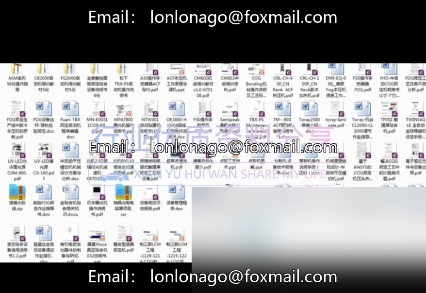
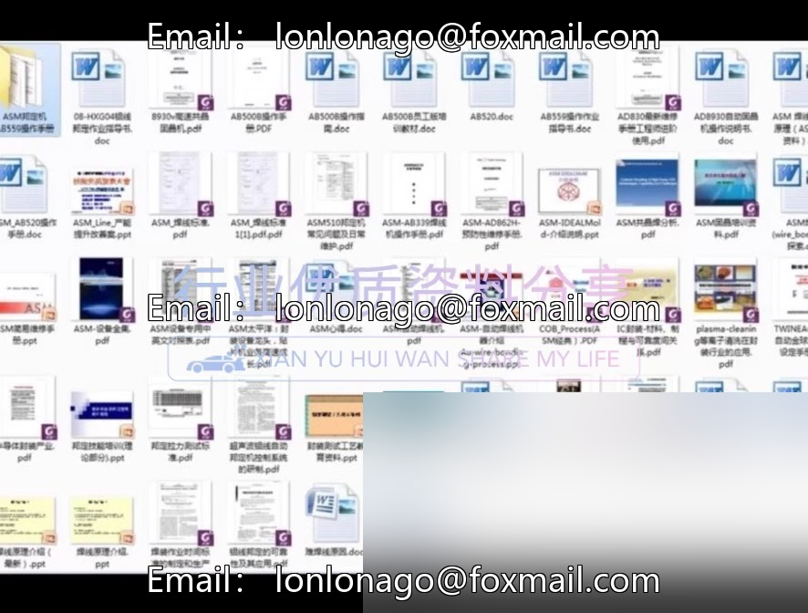

# A S M CO G bonding device technical data package, totaling more than 165+ files, including

## Body

ASM COG bonding equipment technical data package, totaling 165+ documents, including technical descriptions and equipment manuals, ASM crystal welding technology, which is extremely valuable for researching COG, COB, and TP! Low price!

Upload directly to for electronic original files! The following image contains a screenshot of the file portion. Please confirm before placing an order! Because electronic file materials are copyable. So after purchase, no return is allowed! Thank you for understanding!

For personal learning and reference use only.

The ASM COG keying equipment technical material package includes technical instructions and device manuals with 165+ files; the images show multiple equipment and manual items.

<!-- AI_ENRICHED -->

## Images

## Payment

Here is a pay link on Stripe ( https://buy.stripe.com/3cs8yP7sY87d0vu9AB ). Please contact me lonlonago@foxmail.com after funding $89, and I will send you a complete data files , thank you!

